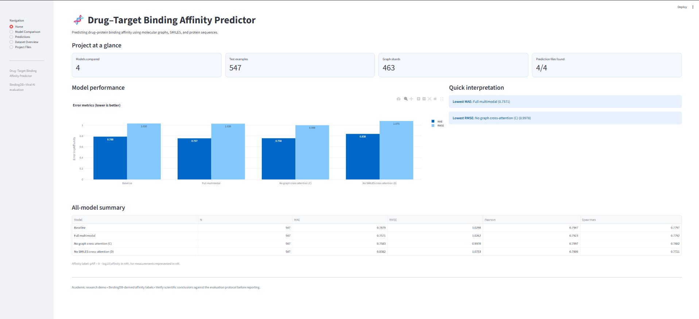
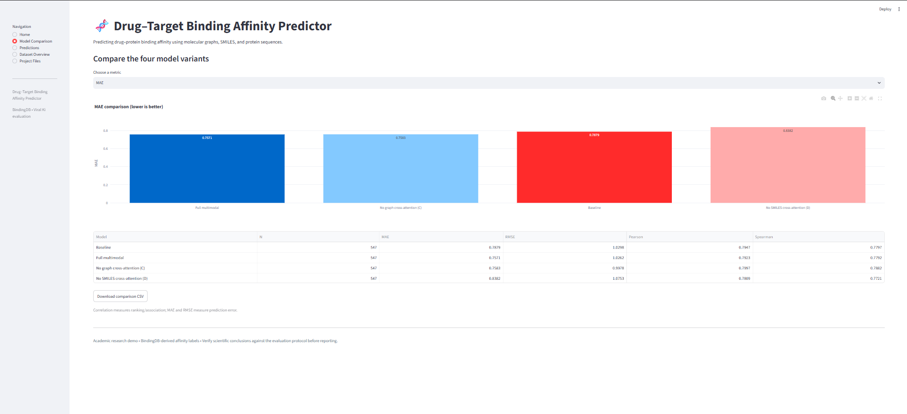
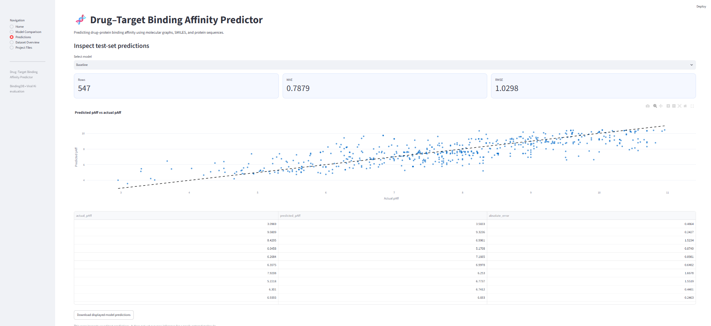
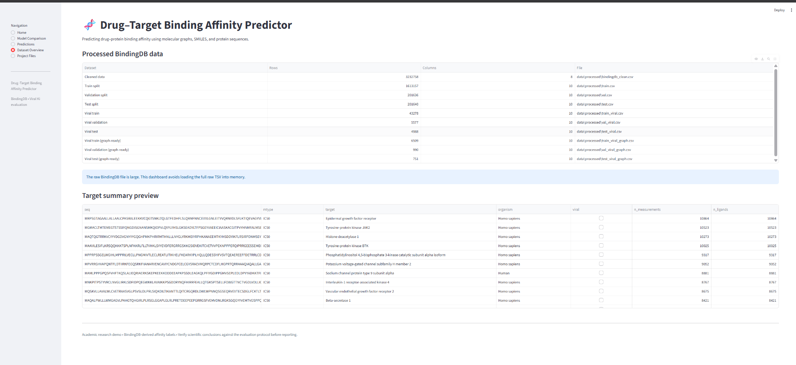
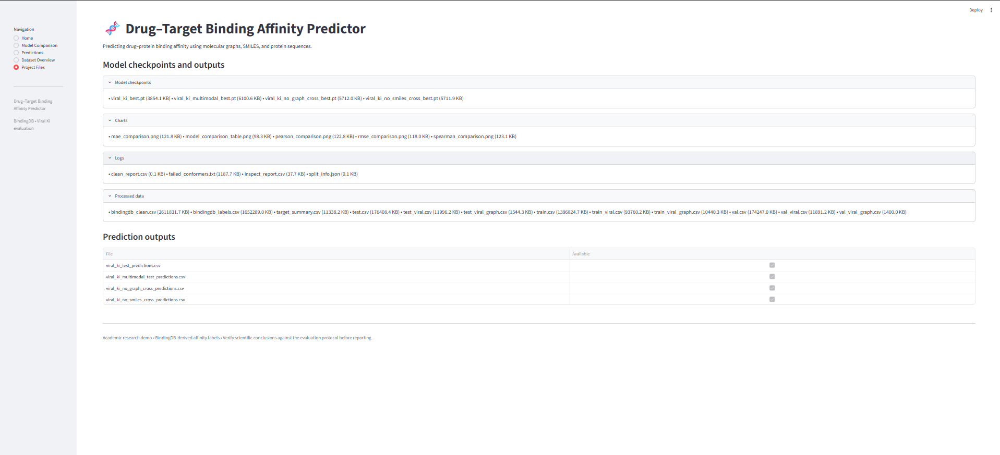

# Drug–Target Binding Affinity Predictor via 3D Graph Transformers

A deep-learning project for predicting drug–target binding affinity using 3D molecular graphs, protein sequences, and (in the multimodal model) SMILES representations. The project includes baseline, multimodal, and ablation experiments, along with evaluation scripts and a Streamlit dashboard.

## Contents

- [Overview](#overview)
- [Architecture](#architecture)
- [Repository structure](#repository-structure)
- [Dataset and preprocessing](#dataset-and-preprocessing)
- [Installation](#installation)
- [Running the project](#running-the-project)
- [Training and evaluation](#training-and-evaluation)
- [Prediction](#prediction)
- [Dashboard](#dashboard)
- [Results](#results)
- [Screenshots](#screenshots)

## Overview

The model learns from a ligand's molecular structure and its target protein sequence to estimate binding affinity. Ligands are represented as molecular graphs with atom features, bond features, and 3D coordinates. Protein sequences are encoded as residue tokens. The multimodal experiment additionally uses a character-level SMILES encoder.

**Main components**

- RDKit-based molecular processing and 3D conformer generation.
- 3D graph Transformer with spatial attention biases.
- Protein sequence encoder.
- Optional SMILES sequence encoder.
- Cross-attention for combining learned representations.
- Baseline, multimodal, and ablation experiments.
- Evaluation scripts and a Streamlit results dashboard.

## Architecture

```mermaid
flowchart TD
    subgraph data["Data preparation"]
        clean["Clean records<br/>clean_bindingdb.py"]
        labels["Prepare affinity labels<br/>prepare_affinity_labels.py"]
        splits["Split datasets<br/>split_bindingdb.py"]
        graphs["Build 3D graphs<br/>build_3d_graphs.py"]
        dataset["Affinity dataset<br/>graph_dataset.py"]
        common["Shared utilities<br/>common.py"]
    end

    subgraph models["Affinity modeling"]
        graphEncoder["3D graph encoder<br/>graph_transformer_3d.py"]
        proteinEncoder["Protein encoder<br/>protein_encoder.py"]
        smilesEncoder["SMILES encoder<br/>smiles_encoder.py"]
        crossAttention["Cross-attention<br/>cross_attention.py"]
        baseline["Baseline model<br/>affinity_model.py"]
        multimodal["Multimodal model<br/>affinity_model_multimodal.py"]
        noGraph["No-graph-cross ablation"]
        noSmiles["No-SMILES-cross ablation"]
    end

    subgraph experiments["Training and evaluation"]
        trainBase["train_bindingdb.py / train_viral.py"]
        trainMulti["train_viral_multimodal.py"]
        trainNoGraph["train_viral_no_graph_cross.py"]
        trainNoSmiles["train_viral_no_smiles_cross.py"]
        evalBase["evaluate_bindingdb.py / evaluate_viral.py"]
        evalMulti["evaluate_multimodal.py"]
    end

    subgraph outputs["Prediction and analysis"]
        predict["predict_affinity.py"]
        app["Streamlit dashboard<br/>app.py"]
        compare["compare_all_models.py"]
        target["analyze_targets.py"]
    end

    bindingdb[("BindingDB records")] --> clean
    clean --> labels --> splits --> graphs --> dataset
    common -.-> clean
    common -.-> labels
    common -.-> splits
    common -.-> graphs
    common -.-> dataset
    dataset --> graphEncoder

    baseline --> graphEncoder
    baseline --> proteinEncoder
    baseline --> crossAttention
    multimodal --> graphEncoder
    multimodal --> proteinEncoder
    multimodal --> smilesEncoder
    multimodal --> crossAttention
    noGraph --> graphEncoder
    noGraph --> proteinEncoder
    noGraph --> smilesEncoder
    noSmiles --> graphEncoder
    noSmiles --> proteinEncoder
    noSmiles --> smilesEncoder

    trainBase --> dataset
    trainBase --> baseline
    trainMulti --> dataset
    trainMulti --> multimodal
    trainNoGraph --> dataset
    trainNoGraph --> noGraph
    trainNoSmiles --> dataset
    trainNoSmiles --> noSmiles
    evalBase --> dataset
    evalBase --> baseline
    evalMulti --> dataset
    evalMulti --> multimodal
    predict --> evalBase
    app --> compare --> target

    click clean "https://github.com/parri-abinaya/drug-target-binding-affinity-predictor-via-graph-transformers/blob/main/src/clean_bindingdb.py"
    click labels "https://github.com/parri-abinaya/drug-target-binding-affinity-predictor-via-graph-transformers/blob/main/src/prepare_affinity_labels.py"
    click splits "https://github.com/parri-abinaya/drug-target-binding-affinity-predictor-via-graph-transformers/blob/main/src/split_bindingdb.py"
    click graphs "https://github.com/parri-abinaya/drug-target-binding-affinity-predictor-via-graph-transformers/blob/main/src/build_3d_graphs.py"
    click dataset "https://github.com/parri-abinaya/drug-target-binding-affinity-predictor-via-graph-transformers/blob/main/src/graph_dataset.py"
    click common "https://github.com/parri-abinaya/drug-target-binding-affinity-predictor-via-graph-transformers/blob/main/src/common.py"
    click graphEncoder "https://github.com/parri-abinaya/drug-target-binding-affinity-predictor-via-graph-transformers/blob/main/src/graph_transformer_3d.py"
    click proteinEncoder "https://github.com/parri-abinaya/drug-target-binding-affinity-predictor-via-graph-transformers/blob/main/src/protein_encoder.py"
    click smilesEncoder "https://github.com/parri-abinaya/drug-target-binding-affinity-predictor-via-graph-transformers/blob/main/src/smiles_encoder.py"
    click crossAttention "https://github.com/parri-abinaya/drug-target-binding-affinity-predictor-via-graph-transformers/blob/main/src/cross_attention.py"
    click baseline "https://github.com/parri-abinaya/drug-target-binding-affinity-predictor-via-graph-transformers/blob/main/src/affinity_model.py"
    click multimodal "https://github.com/parri-abinaya/drug-target-binding-affinity-predictor-via-graph-transformers/blob/main/src/affinity_model_multimodal.py"
    click noGraph "https://github.com/parri-abinaya/drug-target-binding-affinity-predictor-via-graph-transformers/blob/main/src/affinity_model_no_graph_cross.py"
    click noSmiles "https://github.com/parri-abinaya/drug-target-binding-affinity-predictor-via-graph-transformers/blob/main/src/affinity_model_no_smiles_cross.py"
    click trainBase "https://github.com/parri-abinaya/drug-target-binding-affinity-predictor-via-graph-transformers/blob/main/src/train_bindingdb.py"
    click trainMulti "https://github.com/parri-abinaya/drug-target-binding-affinity-predictor-via-graph-transformers/blob/main/src/train_viral_multimodal.py"
    click trainNoGraph "https://github.com/parri-abinaya/drug-target-binding-affinity-predictor-via-graph-transformers/blob/main/src/train_viral_no_graph_cross.py"
    click trainNoSmiles "https://github.com/parri-abinaya/drug-target-binding-affinity-predictor-via-graph-transformers/blob/main/src/train_viral_no_smiles_cross.py"
    click evalBase "https://github.com/parri-abinaya/drug-target-binding-affinity-predictor-via-graph-transformers/blob/main/src/evaluate_bindingdb.py"
    click evalMulti "https://github.com/parri-abinaya/drug-target-binding-affinity-predictor-via-graph-transformers/blob/main/src/evaluate_multimodal.py"
    click predict "https://github.com/parri-abinaya/drug-target-binding-affinity-predictor-via-graph-transformers/blob/main/src/predict_affinity.py"
    click app "https://github.com/parri-abinaya/drug-target-binding-affinity-predictor-via-graph-transformers/blob/main/src/app.py"
    click compare "https://github.com/parri-abinaya/drug-target-binding-affinity-predictor-via-graph-transformers/blob/main/src/compare_all_models.py"
    click target "https://github.com/parri-abinaya/drug-target-binding-affinity-predictor-via-graph-transformers/blob/main/src/analyze_targets.py"
```



### Model details

**3D molecular graph:** RDKit converts SMILES into molecular graphs. The shared featurization uses 23 atom features, 6 bond features, and 3D atom coordinates. Pairwise Euclidean distances provide spatial information to the graph Transformer.

\[
d_{ij}=\|\mathbf{r}_i-\mathbf{r}_j\|_2
\]

Gaussian radial basis functions encode distances:

\[
\phi_k(d_{ij})=\exp[-\gamma(d_{ij}-\mu_k)^2]
\]

The resulting distance features are used as attention biases:

\[
B_h[i,j]=\mathbf{w}_h^\top\boldsymbol{\phi}(d_{ij})+b_h
\]

**Spatial self-attention:**

\[
\operatorname{Attention}_h=\operatorname{softmax}\left(\frac{Q_hK_h^\top}{\sqrt{d_h}}+B_h\right)V_h
\]

**Protein encoder:** amino-acid residues are tokenized and encoded, with sequences handled up to the configured maximum length of 1,000 residues.

**SMILES encoder:** the multimodal variant uses a character-level SMILES representation in addition to the 3D graph representation.

**Cross-attention:** the model combines information from molecular and protein representations. The multimodal architecture also incorporates the SMILES representation.

## Repository structure

```text
drug-target-binding-affinity-predictor-via-graph-transformers/
├── src/
│   ├── clean_bindingdb.py
│   ├── prepare_affinity_labels.py
│   ├── split_bindingdb.py
│   ├── build_3d_graphs.py
│   ├── graph_dataset.py
│   ├── common.py
│   ├── graph_transformer_3d.py
│   ├── protein_encoder.py
│   ├── smiles_encoder.py
│   ├── cross_attention.py
│   ├── affinity_model.py
│   ├── affinity_model_multimodal.py
│   ├── affinity_model_no_graph_cross.py
│   ├── affinity_model_no_smiles_cross.py
│   ├── train_bindingdb.py
│   ├── train_viral.py
│   ├── train_viral_multimodal.py
│   ├── train_viral_no_graph_cross.py
│   ├── train_viral_no_smiles_cross.py
│   ├── evaluate_bindingdb.py
│   ├── evaluate_viral.py
│   ├── evaluate_multimodal.py
│   ├── predict_affinity.py
│   ├── compare_all_models.py
│   ├── analyze_targets.py
│   └── app.py
├── data/                  # Raw data, processed CSVs, and graph shards
├── checkpoints/           # Viral experiment checkpoints
├── models/                # BindingDB checkpoints
├── results/               # Metrics, plots, and experiment outputs
├── logs/                  # Preprocessing and training logs
├── all_model_comparison.csv
├── viral_ki_test_predictions.csv
├── viral_ki_multimodal_test_predictions.csv
├── viral_ki_no_graph_cross_predictions.csv
├── viral_ki_no_smiles_cross_predictions.csv
├── requirements.txt
└── README.md
```

## Dataset and preprocessing

The project uses affinity records from [BindingDB](https://www.bindingdb.org/). Download the dataset separately and place its TSV file in `data/raw/`.

Preprocessing scripts:

| Script | Purpose |
|---|---|
| `clean_bindingdb.py` | Cleans BindingDB records and retains usable SMILES, protein sequences, and affinity values. |
| `prepare_affinity_labels.py` | Converts measurements into p-affinity labels and aggregates repeated measurements. |
| `split_bindingdb.py` | Creates scaffold-based train, validation, and test splits. |
| `build_3d_graphs.py` | Generates 3D molecular graphs and saves graph shards. |
| `graph_dataset.py` | Loads graph data for model training and evaluation. |

Affinity labels are expressed as:

\[
\mathrm{pAff}=9-\log_{10}(K\text{ in nM})
\]

Higher p-affinity values indicate stronger affinity. The label preparation script drops censored measurements by default; use `--keep-censored` to retain them.

The generic scaffold split creates `train.csv`, `val.csv`, and `test.csv`. The viral experiment scripts additionally expect `train_viral_graph.csv`, `val_viral_graph.csv`, and `test_viral_graph.csv` in `data/processed/`. Prepare these viral-specific files before running viral experiments; the generic split command does not create them automatically.

## Installation

```bash
git clone https://github.com/parri-abinaya/drug-target-binding-affinity-predictor-via-graph-transformers.git
cd drug-target-binding-affinity-predictor-via-graph-transformers

python -m venv .venv
```

Activate the environment:

**Windows PowerShell**

```powershell
.\.venv\Scripts\Activate.ps1
```

**macOS / Linux**

```bash
source .venv/bin/activate
```

Install dependencies:

```bash
python -m pip install --upgrade pip
pip install -r requirements.txt
```

If PyTorch Geometric installation fails, install a PyTorch build compatible with your CPU/CUDA setup and follow the [official PyTorch Geometric installation guide](https://pytorch-geometric.readthedocs.io/en/latest/install/installation.html).

## Running the project

Run commands from the repository root.

### 1. Add BindingDB data

Place the downloaded BindingDB TSV file in `data/raw/`.

### 2. Clean the records

```bash
python src/clean_bindingdb.py
```

Optional quick test using the first 100,000 rows:

```bash
python src/clean_bindingdb.py 100000
```

### 3. Prepare affinity labels

```bash
python src/prepare_affinity_labels.py
```

To retain censored measurements:

```bash
python src/prepare_affinity_labels.py --keep-censored
```

### 4. Create scaffold splits

```bash
python src/split_bindingdb.py --seed 42
```

Optional smaller subset:

```bash
python src/split_bindingdb.py --subset 50000 --seed 42
```

### 5. Generate 3D molecular graphs

```bash
python src/build_3d_graphs.py --mtype Ki --workers 6 --batch-size 500
```

For a small test run:

```bash
python src/build_3d_graphs.py --mtype Ki --workers 2 --batch-size 50 --limit 100
```

Generated graph shards are stored in `data/graphs/`. Some molecules may fail conformer generation and are recorded in the log directory.

### 6. Prepare viral graph splits

Before viral training, ensure these files exist:

```text
data/processed/train_viral_graph.csv
data/processed/val_viral_graph.csv
data/processed/test_viral_graph.csv
```

### 7. Train and evaluate

Choose the experiment commands in the next section.

## Training and evaluation

| Experiment | Training command | Evaluation command |
|---|---|---|
| BindingDB baseline | `python src/train_bindingdb.py --mtype Ki --epochs 20 --batch 16 --lr 0.0003 --tag model_Ki` | `python src/evaluate_bindingdb.py --tag model_Ki --split test` |
| Viral baseline | `python src/train_viral.py` | `python src/evaluate_viral.py` |
| Viral multimodal | `python src/train_viral_multimodal.py` | `python src/evaluate_multimodal.py` |
| No graph cross-attention | `python src/train_viral_no_graph_cross.py` | — |
| No SMILES cross-attention | `python src/train_viral_no_smiles_cross.py` | — |

The BindingDB training script supports options such as `--mtype`, `--epochs`, `--batch`, `--lr`, `--max-train`, `--patience`, `--d`, `--tag`, and `--seed`. Use `--help` with a script to inspect its available arguments.

Evaluation reports regression and correlation metrics, including MAE, RMSE, Pearson correlation, and Spearman correlation. Lower MAE/RMSE and higher correlation values are generally preferred.

## Prediction

The command-line prediction script uses a compatible BindingDB baseline checkpoint:

```bash
python src/predict_affinity.py \
  --tag model_Ki \
  --smiles "CC(=O)Oc1ccccc1C(=O)O" \
  --seq "MKT..."
```

Replace the example protein sequence with a valid amino-acid sequence. The checkpoint tag must match a model saved under `models/`. The script returns predicted p-affinity and its conversion to nM:

\[
K_{\mathrm{nM}}=10^{(9-\mathrm{pAff})}
\]

## Dashboard

Launch the Streamlit application:

```bash
streamlit run src/app.py
```

Open the local URL printed by Streamlit (normally `http://localhost:8501`). The dashboard provides:

- **Home:** project summary and experiment overview.
- **Model Comparison:** comparison of the saved model variants and metrics.
- **Predictions:** inspection of saved test predictions and actual-versus-predicted values.
- **Dataset Overview:** preview of available processed datasets.
- **Project Files:** inspection of available result, checkpoint, and log files.

The dashboard visualizes saved experiment outputs; it is not a live interface for submitting a new ligand–protein pair.

## Results

Experiment outputs and prediction files are available in the `results/` directory and the CSV files in the repository root. See those files for the recorded metrics, plots, and model predictions. The dashboard can also be used to inspect the saved comparisons.

## Screenshots

### 1. Dashboard Home



### 2. Model Comparison



### 3. Predictions



### 4. Dataset Overview



### 5. Project Files



Save your five screenshots in `docs/images/` with the filenames `1.png`, `2.png`, `3.png`, `4.png`, and `5.png` so the images render automatically on GitHub.

## Notes

- BindingDB data is not bundled with the repository; download it separately.
- 3D conformer generation can take time and some molecules may fail processing.
- The viral training scripts require the viral graph-ready CSV files listed above.
- Model results depend on the dataset split, preprocessing, random seed, software versions, and hardware.
- Predicted affinity is a computational estimate, not an experimental measurement or medical recommendation.

## References

- [BindingDB](https://www.bindingdb.org/)
- [RDKit](https://www.rdkit.org/docs/)
- [PyTorch](https://pytorch.org/docs/stable/index.html)
- [PyTorch Geometric](https://pytorch-geometric.readthedocs.io/)
- [Streamlit](https://docs.streamlit.io/)

---

**Repository:** [drug-target-binding-affinity-predictor-via-graph-transformers](https://github.com/parri-abinaya/drug-target-binding-affinity-predictor-via-graph-transformers)
